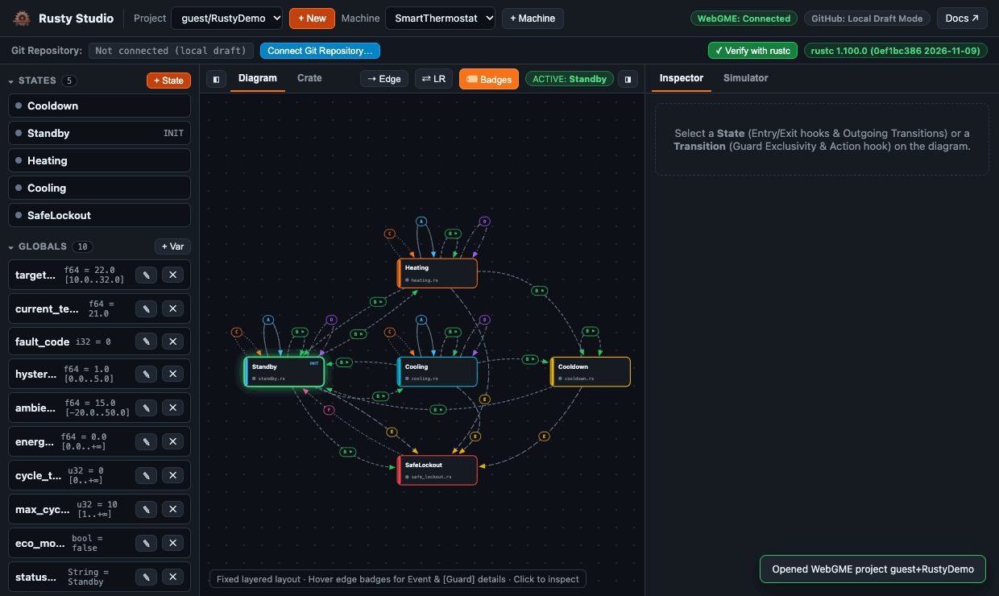

# rusty

Rusty Studio pairs visual state machine design in a central version-controlled database (WebGME) with Git-backed Rust state modules via [`webgme-git`](https://github.com/kecso/webgme-git):

- **Visual Design, Version-Controlled**: Design states, guarded transitions, events, and shared data visually on a clean fixed layered diagram and store your architecture in a central version-controlled model database.
- **Hybrid Code Stored in Plain Git**: Edit each state's Rust implementation inside the studio's embedded Monaco editor while the files themselves live in a standard Git repository (bound at the machine directory level, with optional per-state overrides) so your code can also be edited, tested, or built in any external IDE without the web UI.
- **Continuous Edit & Design-Impact Checks**: Every keystroke and transition guard is checked immediately against your model—and whenever you rename, retype, or remove an element in the design, Rusty highlights every affected state and guard automatically via tracked WebGME `dependsOn` Sets.
- **Standalone Rust Crates & Verification**: Test behavior interactively in the browser, verify execution parity against compiled native Rust (`rustc` / `cargo`), export standalone zero-dependency Cargo crates, or sweep existing GitHub directories back into WebGME (`ImportFromGitHub`).



## Step-by-Step Tutorial & Pre-Seeded Demo Showcases

- **From-Scratch Tutorial**: Follow [**Build a Simple Counter**](https://kecso.github.io/rusty/tutorial/00-build-a-counter.html) (`docs/tutorial/00-build-a-counter.md`) to sign in via GitHub, bind your fork's `dev` directory, design states/globals/events/guards, experience design-impact tracking, and export a standalone crate.
- **Pre-Seeded Demo Showcases** (`seed/RustySeed.webgmex` & [`examples/`](./examples/README.md), using machine-level `gitRepo = rusty`, `gitBranch = dev`, blank `gitOwner` so you bind `<your-username>/rusty@dev`):
  - [`examples/blinky/`](./examples/blinky) — **BlinkyController**: GPIO blink loop, thermal limit guard, fault recovery.
  - [`examples/smart-thermostat/`](./examples/smart-thermostat) — **SmartThermostat**: HVAC controller with thermal drift physics, payload events, self-emitted alerts, cooldown, and lockout recovery.

## Tutorial Documentation (VitePress)

Browse the published docs at **[https://kecso.github.io/rusty/](https://kecso.github.io/rusty/)** or preview them locally from [`docs/`](./docs/index.md):

```bash
npm run docs:dev     # Live local VitePress docs server
npm run docs:build   # Build static docs served at http://127.0.0.1:8888/routers/studio/docs/
```

## Architecture

| Component | Path | Role |
| --- | --- | --- |
| WebGME Server | `app.js`, `config/` | Standalone WebGME host wiring `webgme-git`, seeds, plugins, and routers |
| Metamodel & Seed | `metamodel/Language.json`, `seed/RustySeed.webgmex` | `GitArtifactLink` mixin, `dependsOn` Set + `depsSignature`, and seeded examples |
| Tutorial Examples | `examples/blinky/`, `examples/smart-thermostat/` | Standalone runnable Cargo crates bound at machine directory level on `dev` |
| Documentation Site | `docs/` | VitePress counter tutorial, demo showcases, concepts, and reference |
| `webgme-git` Adapter | `src/routers/GitRouterAdapter/` | Mounts `webgme-git/src/routers/GitRouter` at `/routers/gitrouter` wired to `gmeAuth` + `ProjectRepoStore` |
| Rust Sim / Check Router | `src/routers/RustSimRouter/` | `/routers/rustsim` (`GET /health`, `POST /generate`, `POST /check`, `POST /run`) |
| Rusty Studio UI | `src/routers/StudioRouter/` | Fixed-layout interactive diagram, Monaco editor, simulator, and crate viewer |
| Shared Rust Engine | `src/common/` | UMD modules (`rustContract.js`, `rustAnalyzer.js`, `rustCodegen.js`, `rustSimEngine.js`, `rustLayout.js`, `rustImporter.js`) |
| WebGME Plugins | `src/plugins/GenerateRustCrate/`, `src/plugins/ImportFromGitHub/` | Export standalone Cargo crates or sweep GitHub directories to rebuild WebGME models |

## Quick Start

### 1. Prerequisites
- Node.js >= 18
- MongoDB (`mongod` on `127.0.0.1:27017`)
- Rust toolchain (`rustc` + `cargo`)

### 2. Fork, Clone & Start (Local Dev / Guest Mode)

Fork [`kecso/rusty`](https://github.com/kecso/rusty) on GitHub first, clone your fork, and create a `dev` sandbox branch on it:

```bash
git clone https://github.com/<your-username>/rusty.git
cd rusty
git checkout -b dev
git push -u origin dev
git checkout main

npm install
npm run docs:build   # Optional: builds /routers/studio/docs/
npm start
```

Open:
- **Rusty Studio**: `http://127.0.0.1:8888/routers/studio`
- **Built Tutorials**: `http://127.0.0.1:8888/routers/studio/docs/`
- **WebGME Generic UI**: `http://127.0.0.1:8888/`

### 3. Enable Full GitHub Sync (`webgme-git` OAuth + `/profile`)

```bash
cp .env.example .env
# Fill in GITHUB_APP_ID, GITHUB_APP_CLIENT_ID, GITHUB_APP_CLIENT_SECRET,
# GITHUB_APP_PRIVATE_KEY_PATH, TOKEN_ENCRYPTION_KEY (openssl rand -hex 32)
# and set RUSTY_AUTH=true
npm start
```

1. Install your GitHub App on `<your-username>/rusty` and sign in at `http://127.0.0.1:8888/profile/login`
2. Link `<your-username>/rusty` to your project in `/profile`
3. In **Rusty Studio**, click **Bind GitHub Repo…** and set `Owner = <your-username>`, `Repo = rusty`, `Branch = dev`!

## Scripts

```bash
npm start          # Start WebGME server + Rusty Studio
npm test           # Run unit, router, analyzer, codegen, and native Rust parity tests
npm run sync:examples # Regenerate examples/ from src/common/rustContract.js
npm run build:seed # Rebuild seed/RustySeed.webgmex from metamodel/Language.json
npm run docs:dev   # Preview VitePress tutorial docs locally
npm run docs:build # Build VitePress docs for /routers/studio/docs/
```

## Local Co-Development (`npm link`)

`package.json` depends directly on the GitHub sources (`github:kecso/webgme-git` and `github:kecso/webgme-json-importer`) with zero relative `file:` paths. When developing those libraries side-by-side locally, use `npm link`:

```bash
# 1. Register shared local packages once:
(cd /path/to/webgme-json-importer && npm link)
(cd /path/to/webgme-git && npm link && npm link webgme-json-importer)

# 2. Link them into rusty after npm install:
npm install
npm link webgme-git webgme-json-importer
```

## License

MIT
